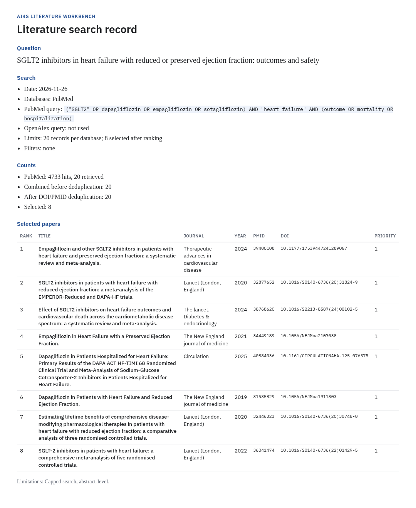
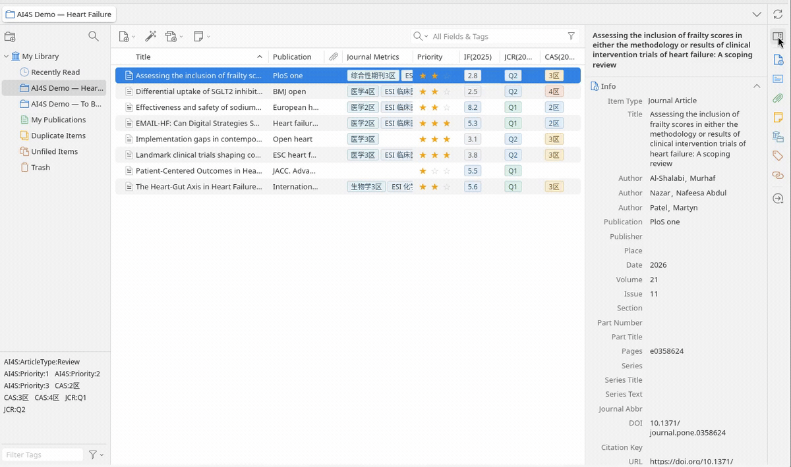
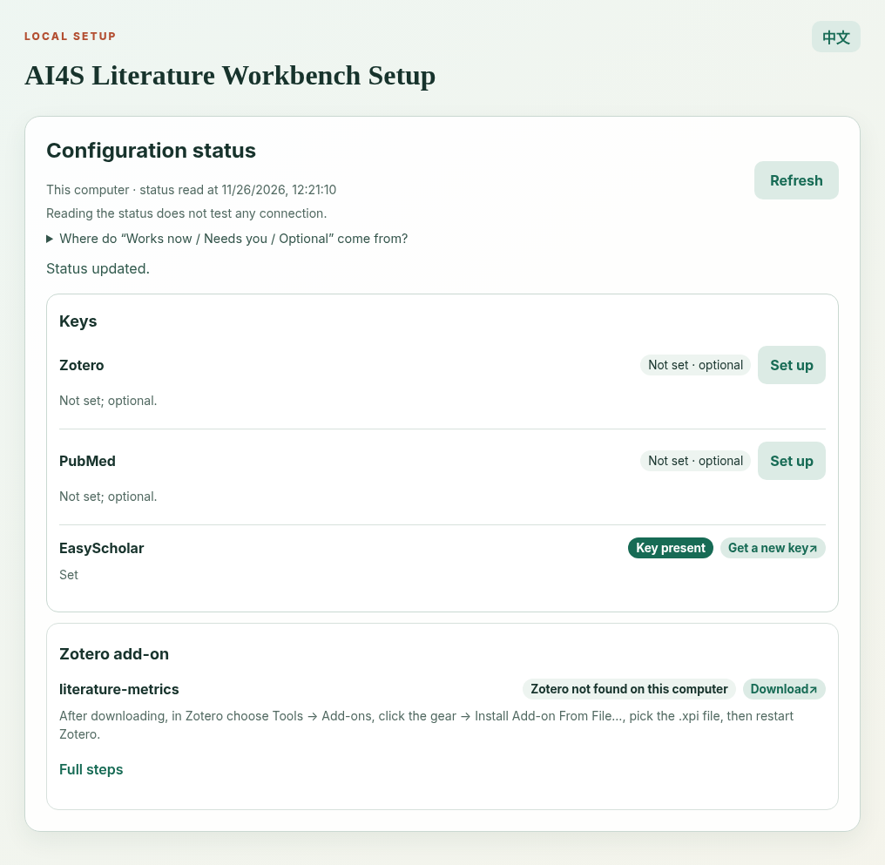

<h1 align="center">📚 AI4S Literature Workbench</h1>

<p align="center">
  <strong>An all-in-one, evidence-traced literature workbench powered by Zotero and AI Agents</strong><br>
  <em>Write literature reviews and proposals without losing track of where every citation came from</em>
</p>

<p align="center">
  🔎 Natural-Language Search · 📚 Zotero Integration · ✍️ Traceable Citations
</p>
<p align="center">
  <a href="https://github.com/Frankkk1912/ai4s-literature-workbench/releases">📥 Releases</a> ·
  <a href="README_CN.md">🇨🇳 中文文档</a> ·
  <a href="#-quick-start">🚀 Quick Start</a> ·
  <a href="docs/getting-started.md">📖 Getting Started</a>
</p>

---

## 🤔 Why This Workbench?

Describe your research question in plain language. The workbench searches PubMed and OpenAlex, deduplicates the results, and saves an auditable search record. It can sync selected papers to Zotero and draft from the saved evidence with `[EV:n]` citation markers.

| Stage | What you get |
| --- | --- |
| 🔎 **Search & Rank** | PubMed and OpenAlex results, DOI/PMID deduplication, relevance scores, and Priority 1–3 reading order |
| 📚 **Sync to Zotero** | Selected papers and the search record in one collection, with exact DOI/PMID reuse to avoid duplicates |
| ✍️ **Traceable Drafting** | Claims linked to saved evidence, plus a separate list of weak, abstract-only, or unresolved citations |

Searches are capped and initial screening relies primarily on abstracts. The search record makes both limits visible.

## ⚔️ How It Compares

| | AI4S Literature Workbench | Manual Workflow | General Chatbots |
| --- | --- | --- | --- |
| 📄 **Paper Sources** | Live PubMed and OpenAlex search, merged by DOI or PMID | Manual browsing across databases | Model memory; citations may be invented |
| 📝 **Search Audit Trail** | `report.md` saves the question, queries, and counts | Scattered personal notes | No reproducible project search log |
| 📚 **Zotero Integration** | Keyless local read; API key or Zotero 10+ authorization for writes | Manual import and tagging | No direct access to your Zotero library |
| 📊 **IF & Quartiles** | Bundled 2025 JCR/IF data; CAS zones through EasyScholar or a custom metrics file | Journal-by-journal lookup | Metrics may be unverified or outdated |
| ✍️ **Review Drafting** | `[EV:n]` links to saved evidence, plus a citation check list | Memory and manual note searches | No direct access to your curated evidence |

## 🧰 Core Features

### 🔎 Retrieval & Ranking

The default search queries PubMed and OpenAlex in parallel. OpenAlex needs no API key. Results are merged by DOI first, then PMID.

Each run saves `report.md` with the question, exact queries, limits, and counts. `ranked_all.json` stores the evidence and scoring reasons. Priority 1–3 is a reading order for the current topic, not an evidence-quality score. Manual Priority changes are preserved by later imports.

Journal metrics use the bundled, reviewed 2025 JCR/IF table matched by ISSN. CAS zones come from EasyScholar or a custom metrics file. Metrics do not change search recall.

arXiv is added only on request. Web of Science supports official CSV/TSV exports downloaded by the user.

<p align="center"></p>

*An example PubMed search record (`report.md`): the question, exact query, hit counts, and selected papers.*

### 📚 Zotero Sync

Local Zotero reading needs no API key. Writing uses either a Zotero API key or local authorization in Zotero 10+.

Project sync reuses exact DOI/PMID matches and keeps the search record as a note in the target collection. Fuzzy title-year matches require your confirmation.

### ✍️ Evidence-Traced Writing & Full Text

Writing requires saved `ranked_all.json` evidence. Drafts use `[EV:n]` markers and a reference audit table. Weak, abstract-only, or unresolved citations go to `references_to_check.md` when present.

**Full text is retrieved only from lawful open-access sources.** The runtime uses public HTTP/HTTPS OA routes and verifies the main-article PDF. It does not use institutional login or access-control workarounds. Until full text is retrieved, evidence remains abstract-level.

### 📊 The `literature-metrics` Zotero Add-on

The optional Zotero Desktop add-on displays **IF / JCR / CAS**, **Priority**, **Article Type**, **Agent Tags**, and **AI Summary** columns. Values come from each item's `Extra` field after an agent sync or refresh.

Clicking stars, pressing `1` / `2` / `3`, or using **Set Priority** changes only Priority tags. The add-on performs no other writes.

<p align="center"></p>

*Sorting by Impact Factor and Priority in Zotero, with the item pane updating as rows are selected.*

### 🔑 Optional Local API Keys

Search, ranking, and drafting work without keys. Add a key only for the extra capability you need.

| Key | What it unlocks | How to get one |
| --- | --- | --- |
| **PubMed** | Higher PubMed request rate limits | Free with an NCBI account |
| **Zotero** | Writing papers and metadata to your Zotero library | Free with a Zotero account |
| **EasyScholar** | Additional journal ratings, including CAS zones | Issued under EasyScholar's own terms |

The local setup page provides the registration links. Ask the agent to open the key page, then paste each key into its masked input field. Keys are saved in a private local file. They are not pasted into chat or exposed to the agent.

Local Zotero reading needs no key. Zotero 10+ can also authorize local writes without a key; earlier versions support keyless local reads only.

PubMed and EasyScholar keys take effect on the next search. Restart the client after adding a Zotero key, then run `ai4s-setup` again to confirm. If all keys are already configured, you can still ask for the key page to change one.

<p align="center"></p>

*The local setup page in a demo environment.*

## 🗣️ Example Prompts

### 1. Search and Rank Literature
```text
Retrieve and rank PubMed and OpenAlex evidence on GLP-1 receptor agonists and cardiovascular outcomes. Save the search record for later writing.
```

### 2. Sync to a Zotero Collection
```text
Sync this search record and the selected papers into a Zotero collection named "GLP-1 CVD Project". Reuse items that match on DOI or PMID.
```

### 3. Draft an Evidence-Traced Review Section
```text
Draft an English review section from my saved ranked evidence and search record. Use [EV:n] placeholders and list references that need checking.
```

## 🚀 Quick Start

### Prerequisites

- A supported client: **Claude Desktop**, **Claude Code**, **Codex**, **ChatGPT desktop**, WorkBuddy, CodeBuddy, Trae, or Qoder.
- **Zotero Desktop** for collection syncing and metric columns.
- A browser for the optional local key page.

### 1. Install (Pick Your App)

**Claude Desktop — Code tab**

1. Download `ai4s-literature-workbench-<version>.zip` from [Latest Release](https://github.com/Frankkk1912/ai4s-literature-workbench/releases/latest) and check `SHA256SUMS.txt`.
2. Choose **Settings → Plugins → Add → Upload plugin** and select the zip.
3. Run `/reload-plugins` or start a new session.

**Claude Desktop — Chat**

1. Upload the same zip through **Settings → Plugins → Add → Upload plugin**. This installs four skills only.
2. Download **both** `ai4s-literature-zotero-<version>.mcpb` and `ai4s-literature-fulltext-<version>.mcpb`. Check each against `SHA256SUMS.txt`; stop if either is missing or fails the check.
3. Open both files and press **Install**. Leave Zotero's optional settings unchanged; fulltext has no required settings or keys. Restart Claude Desktop.

Chat does not load plugin-local MCP servers. The two separate extensions provide the tools.

**Claude Code terminal, Codex, ChatGPT desktop, or WorkBuddy**

Paste this prompt into the client:

```text
Please install the plugin from
https://github.com/Frankkk1912/ai4s-literature-workbench.git
into this app. Follow INSTALL.md exactly, and if you cannot open the repository read
https://raw.githubusercontent.com/Frankkk1912/ai4s-literature-workbench/main/INSTALL.md
Do not add steps of your own. When it's done, tell me in plain language what works now and what I need to do myself.
```

Select **Allow** if the client requests GitHub or network access. For direct commands and other clients, use **Other agents & manual install** below.

### 2. First Run

Ask the agent to run `ai4s-setup`. It checks the connection, reports what works, and runs a small real search. In skills-only Claude Chat, install the two extensions above first.

On the first search, approve the download of the search helper when asked. It is about 15 MB, plus about 30 MB of Python if none is available. It installs in your user directory without admin rights or system-wide changes.

- **Keys:** All optional. Add them only through the local setup page, never in chat.
- **Local Zotero read:** Enable **Settings → Advanced → Allow other applications on this computer to communicate with Zotero**.
- **Zotero write:** Add a Zotero API key on the setup page, or use Zotero 10+ and choose **Always Allow** when prompted.
- **Metric columns:** Install [`literature-metrics.xpi`](https://github.com/Frankkk1912/ai4s-literature-workbench/releases/latest/download/literature-metrics.xpi) through **Tools → Add-ons → Gear icon → Install Add-on From File…**. Restart Zotero, then ask the agent to sync or refresh a collection.

### 3. Run Your First Search

Start with the **Search and Rank Literature** prompt above. Then try the Zotero sync and drafting prompts.

For a full walkthrough, see `docs/getting-started.md`.

<details>
<summary>Installation verification & fallback notes</summary>

- **Desktop Code:** Upload and recognition of four skills and two local servers were verified on Mac with v0.2.0. That published zip has broken relative MCP paths. The path fix is not yet desktop-verified or included in that asset.
- **Desktop Code marketplace alternative:** Choose **Add → Add marketplace**, enter `Frankkk1912/ai4s-literature-workbench`, install the plugin, and build the source once. This route is unverified. In this tab, `/plugin` opens settings; it does not run terminal install commands.
- **Desktop Chat:** Four uploaded skills were verified on Mac with v0.2.0. Both `.mcpb` extensions are CI-built and validated, but not live-verified. They use Claude Desktop's bundled Node.js; its version is unverified and the bundles require ≥ 22.13.
- **Config-only routes:** The ChatGPT desktop and WorkBuddy MCP file routes were verified on Windows 11. These routes connect tools without loading skills. Other named routes and platforms remain unverified where noted in `INSTALL.md`.
- **Zotero 10+ local write:** The keyless write path passed mock tests of the documented protocol. It has not been verified with a live Zotero 10+ desktop window.
- **Protected Claude config:** Never ask an agent to edit files under `~/Library/Application Support/Claude/`. Mac protects that directory and agent access was denied. The manual config in [INSTALL.md](INSTALL.md) is a user-only last resort.

</details>

<details>
<summary>Troubleshooting</summary>

| Symptom | Resolution |
| --- | --- |
| `"My search tools are not connected yet"` | Restart the client and ask it to run `ai4s-setup`. |
| Local setup page does not open | Open the agent-provided URL and enter the short code. Or double-click `Setup AI4S.bat` (Windows) / `Setup AI4S.command` (macOS) in the extracted release folder. On macOS, use right-click → **Open** → **Open** if blocked. |
| Cannot read or write Zotero | Recheck the Zotero settings in **First Run**. |
| Metric columns are missing or empty | Confirm the add-on is installed, restart Zotero, and ask the agent to sync or refresh the collection. |

</details>

<details>
<summary>Other agents & manual install</summary>

Manual source installation requires Git and Node.js ≥ 22.13 with npm. Run the same commands on Windows. Use `node` directly; do not use `.ps1` or `.sh` wrappers. The first search downloads the search helper, so manual `uv` installation is unnecessary.

```bash
git clone https://github.com/Frankkk1912/ai4s-literature-workbench.git
cd ai4s-literature-workbench
node scripts/bootstrap.mjs
```

**Claude Code terminal** — run these commands in the terminal, not the desktop Code tab. Restart Claude Code afterwards.

```bash
claude plugin marketplace add Frankkk1912/ai4s-literature-workbench
claude plugin install ai4s-literature-workbench@ai4s-literature-workbench
```

**Codex and ChatGPT desktop** — prefer the installation prompt above. For alternative or manual routes, follow the client-specific instructions in [INSTALL.md](INSTALL.md); the ChatGPT MCP configuration route does not load skills.

**WorkBuddy** — prefer the installation prompt above. The MCP config fallback is documented in [INSTALL.md](INSTALL.md).

**CodeBuddy** *(unverified)* — run inside the application, then restart:

```bash
/plugin marketplace add Frankkk1912/ai4s-literature-workbench
/plugin install ai4s-literature-workbench@ai4s-literature-workbench
```

**Trae / Qoder** — from the repository root, replace `/path/to/project` with your target workspace:

```bash
node scripts/install-host.mjs --host trae --target /path/to/project
node scripts/install-host.mjs --host qoder --target /path/to/project
```

</details>

<details>
<summary>For developers</summary>

`install-manifest.json` is the machine-readable companion to `INSTALL.md`. Agents follow those files.

From the repository root, bootstrap and run the checks:

```bash
node scripts/bootstrap.mjs
node --import ./runtime/node_modules/tsx/dist/loader.mjs --test "tests/*.test.mjs"
(cd runtime && npm run typecheck && npm test)
(cd fulltext-runtime && npm run typecheck && npm test)
(cd literature-metrics && npm ci && npm run check && npm test && npm run package)
```

The runtime packages require Node.js ≥ 22.13. Component guides are in `docs/`; security notes are in `SECURITY.md`.

</details>

## 🤝 Contributing

Issues and pull requests are welcome.

## 📄 License

MIT, see `LICENSE`. © Frank AI4S Skill contributors.

The Zotero layer credits Oscar Devos's [Zoteus](https://github.com/oscardvs/zoteus). Component credits are in `THIRD_PARTY_NOTICES.md`.

---

<p align="center">
  <sub>📚 AI4S Literature Workbench · Which sentence came from which paper.</sub>
</p>
