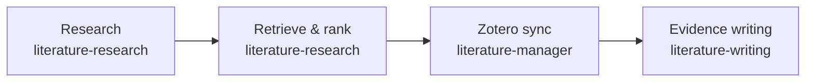

# AI4S Literature Workbench

[中文文档](README_CN.md)

> Turn your research question into a ranked reading list, an organized Zotero collection, and a draft you can trace back to evidence.


<!-- Screenshot: Show a Zotero project collection with colored IF/JCR/CAS columns and reading Priority controls. -->
<!--  -->

## What it does
Stop switching between database searches, journal lookups, and scattered citation notes. When you research a biomedical question, you need to know which papers matter—and which claims they actually support.

Describe your question in one sentence. Use the built-in tools to retrieve and rank papers, keep selected evidence with your report in Zotero, and draft from that saved evidence. Review the search coverage and abstract/full-text limits before drawing conclusions.



See what you get: a reading table with ranking reasons, matched 2025 JCR metrics, and source links, alongside a research report.
<!-- Screenshot: Show ranked_all.csv beside report.md, with ranking reasons, matched 2025 JCR metrics, and source links. -->
<!--  -->

## Try it: say this, get that
### Find papers worth reading
```text
Retrieve and rank PubMed evidence on GLP-1 receptor agonists and cardiovascular outcomes. Save the evidence and report for later writing.
```
Get a deduplicated reading list, ranking reasons, and a saved report you can inspect.

### Keep your project together in Zotero
```text
Sync my finalized literature report and selected papers into a Zotero collection named "GLP-1 CVD Project".
```
Keep your report note and selected papers in the same collection; reuse exact DOI/PMID matches instead of creating them again.

### Draft with evidence you can check
```text
Draft an English literature review section from my saved ranked evidence and report. Use [EV:n] citation placeholders and flag references that need checking.
```
Get a draft with evidence-linked claims and a reference audit table; get a separate check list when citations need attention.
<!-- Screenshot: Show a review paragraph with [EV:n] placeholders beside its reference audit table. -->
<!--  -->

## Why you'll love it
- **Choose your next read** — Compare relevance and ranking reasons, with journal metrics matched from the bundled 2025 JCR table.
- **Find your project again** — Keep selected papers and the current report together in Zotero; request reusable English tags or a Chinese summary sentence when you need them.
- **Check what your draft says** — Trace claims to saved evidence through citation placeholders and a reference audit table.
- **Stay in control of changes** — Preview batch imports and metric refreshes, confirm before writing, and keep a record of changes.
- **Keep keys out of chat** — Enter optional credentials yourself through masked setup on your own computer.
<details>
<summary>Included skills</summary>

`literature-research` — retrieve and rank; `literature-manager` — organize in Zotero; `literature-writing` — draft from evidence.
</details>

## What's inside
The workbench ships in two pieces. Use either on its own, or together.

### Built-in tools for your agent
Your agent can call these on your behalf — they speak the same protocol your agent already understands (MCP, Model Context Protocol), so the conversation stays in plain language.
- **Find and rank** — pull papers from configured sources, dedupe, and rank by relevance. (`search-items`, `find-duplicates`)
- **Sync to your Zotero collection** — match by DOI/PMID, write a single project note, never re-create what you already have. (`sync-literature-project`, `apply-import-plan`, `manage-collections`)
- **Tag and summarize** — clean redundant source tags, apply `AI4S:Semantic:*` tags, add a one-sentence Chinese summary to each item. (`apply-semantic-tags`, `apply-ai-summaries`, `cleanup-auto-tags`, `tag-audit`)
- **Cite and draft** — turn ranked evidence into a draft with `[EV:n]` placeholders, format references, export. (`apply-citation-plan`, `format-bibliography`, `export`)
- **Audit and metrics** — keep an evidence-to-claim table, audit tag consistency, refresh journal indicators. (`tag-audit`, `apply-metrics-plan`)

### Zotero Desktop add-on
A separate XPI you install into Zotero Desktop ([download the newest](https://github.com/Frankkk1912/ai4s-literature-workbench/releases/latest/download/literature-metrics.xpi), then Tools → Add-ons → gear → Install Add-on From File…; [details](docs/zotero-xpi.md)). It adds columns and controls on the right of your library, all read-only by default:
- Colored **IF / JCR / CAS** columns for at-a-glance journal quality
- **Article Type** auto-detection, **AI Summary** field, **Agent Tags** for fast navigation
- **Priority 1 / 2 / 3** — the only direct write path, set explicitly by you with a star control, number shortcut, or context menu


## Get started

### What you need
- An agent app: **Claude Desktop**, **Claude Code**, **Codex**, WorkBuddy, CodeBuddy, Trae or Qoder.
- **Zotero Desktop**, if you want your papers organized there and the journal columns.
- A web browser, for the page where you paste optional keys.

That is all you install yourself. If your computer also needs a small free tool (Node.js, or the search helper `uv`), your agent says so, asks first, and tells you where to get it. Claude Desktop needs neither for the Zotero tools.

### 1. Install (pick your app)

**Claude Desktop** (Zotero tools only; the skills and full-text tools are not included)
1. Open the [latest release](https://github.com/Frankkk1912/ai4s-literature-workbench/releases/latest) and download `ai4s-literature-zotero-<version>.mcpb`.
2. Double-click it, or drag it onto the Claude Desktop window, and accept the install screen. Leave the two optional settings as they are.

**Claude Code, Codex, WorkBuddy, CodeBuddy**: paste this into the app:
> Please install the plugin from https://github.com/Frankkk1912/ai4s-literature-workbench.git into this app. Follow INSTALL.md in that repository exactly and do not add steps of your own. When it's done, tell me in plain language what works now and what I need to do myself.

**Trae, Qoder**: see "Other agents & manual install" below.

Before you start: your app may ask permission to reach GitHub or the network. Choose **Allow**; the install cannot continue without it. WorkBuddy and CodeBuddy have not been tested on a real machine yet.

### 2. First-run setup
Your agent runs the `ai4s-setup` skill: it tells you in plain words what works now and what needs you.
- **Keys are optional.** Search, ranking and drafting need none. If you want one, the agent opens a page on your own computer; paste the key there, never into chat.
- **Reading your Zotero library needs no key.** Open Zotero and, in Settings → Advanced, tick **Allow other applications on this computer to communicate with Zotero**.
- **Saving to Zotero** needs a Zotero key, or Zotero 10 or later (it asks once in its own window; choose Always Allow).
- **Journal columns in Zotero** (IF / JCR / CAS): download [the add-on](https://github.com/Frankkk1912/ai4s-literature-workbench/releases/latest/download/literature-metrics.xpi), then in Zotero choose Tools → Add-ons, click the gear → Install Add-on From File…, pick the file, and restart Zotero.

### 3. Say your first prompt
Start with **Find papers worth reading** above. The first search should take a few minutes at most.

### If something goes wrong
| What you see | What to do |
| --- | --- |
| The agent says "My search tools are not connected yet" | Restart the app, then ask: "run the ai4s-setup skill". |
| The setup page did not open | The agent gives you an address and a short code: open the address and type the code. Or double-click `Setup AI4S.bat` (Windows) / `Setup AI4S.command` (Mac) in the extracted release folder. On a Mac, if it is blocked, right-click it, choose Open, then Open. |
| The agent cannot read my Zotero library | Open Zotero and tick **Allow other applications on this computer to communicate with Zotero** in Settings → Advanced. |
| It cannot save to Zotero | Add a Zotero key on the setup page, or use Zotero 10 or later and choose Always Allow when Zotero asks. |
| No journal columns in Zotero | Install the add-on (step 2), restart Zotero, then ask the agent to sync or refresh a collection: the columns show data the tools wrote to your items. |
| The app asks to reach GitHub or the network | Choose Allow. |

More detail: [Getting started](docs/getting-started.md).

### Keys, in plain words
- **What is a key?** A long password-like string that lets this tool use a service as you. You paste it into the setup page on your own computer; it is stored in a private file there and never shown in chat.
- **Which are free?** A PubMed key is free with an NCBI account. A Zotero key is free with a Zotero account. EasyScholar issues its own; check their terms.
- **Why does search work without any?** Searching uses public sources. Keys raise PubMed's request allowance, let the tools save to Zotero, and add more journal ratings.

<details>
<summary>Other agents & manual install</summary>

Install Git, Node.js ≥22.13 with npm, and uv. Clone and build:
```bash
git clone https://github.com/Frankkk1912/ai4s-literature-workbench.git
cd ai4s-literature-workbench
node scripts/bootstrap.mjs
```
On Windows, run `git clone` and `cd` as above, then the same `node scripts/bootstrap.mjs` command.
Choose your agent's commands. Run Trae/Qoder commands from this checkout; replace `/path/to/project` with your project folder. Those commands add built-in tools to that project.

**Claude Code**
```bash
claude plugin marketplace add Frankkk1912/ai4s-literature-workbench
claude plugin install ai4s-literature-workbench@ai4s-literature-workbench
```
**Codex**
```bash
codex plugin marketplace add https://github.com/Frankkk1912/ai4s-literature-workbench.git
codex plugin add ai4s-literature-workbench@personal
```
**Trae / Qoder** — choose the line for your app.
```bash
node scripts/install-host.mjs --host trae --target /path/to/project
node scripts/install-host.mjs --host qoder --target /path/to/project
```
</details>

---

## For Developers

### Project Structure
```text
ai4s-literature-workbench/
├── .claude-plugin/            # Claude Code manifests and marketplace
├── .codex-plugin/             # Codex manifest and default prompts
├── docs/                      # Setup and component guides
├── scripts/                   # Install, build, and verification scripts
├── skills/                    # Retrieval, Zotero management, and writing skills
├── runtime/                   # Zotero tools and local configuration service
├── fulltext-runtime/          # Open-access full-text retrieval and PDF checks
├── database-browser-runtime/  # Visible-browser access to authorized databases
├── literature-metrics/        # Zotero Desktop add-on source
└── tests/                     # Repository-level tests
```

### Development
Run from the repository root; build installs the Zotero/full-text dependencies:
```bash
node scripts/bootstrap.mjs
node --import ./runtime/node_modules/tsx/dist/loader.mjs --test "tests/*.test.mjs"
(cd runtime && npm run typecheck && npm test)
(cd fulltext-runtime && npm run typecheck && npm test)
(cd database-browser-runtime && npm ci && npx playwright install chromium && npm run build && npm run typecheck && npm test)
(cd literature-metrics && npm ci && npm run check && npm test && npm run package)
```

### Docs
- [Getting started (step by step, with troubleshooting)](docs/getting-started.md)
- [Zotero Desktop add-on: install, updates and build](docs/zotero-xpi.md)
- [First-run setup and credentials (developer reference)](docs/dev/onboarding.md)
- [Local configuration status view (developer reference)](docs/dev/local-dashboard.md)
- [Release checklist](docs/dev/release-checklist.md)

### Citation & Acknowledgements
Follow **No Evidence, No Conclusion**: trace scientific claims to saved evidence.
Credit Frank AI4S Skill contributors and Oscar Devos's [Zoteus](https://github.com/oscardvs/zoteus). See [third-party notices](THIRD_PARTY_NOTICES.md) for component credits and licenses.

### License
[MIT](LICENSE) © Frank AI4S Skill contributors.
