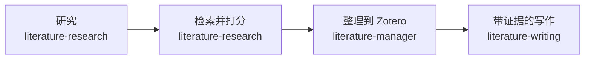

# AI4S Literature Workbench

[English](README.md)

> 把你的研究问题变成有排序的阅读清单、整理好的 Zotero 文库分类，以及能回溯到证据的草稿。


<!-- Screenshot: 展示 Zotero 项目分类中的彩色 IF/JCR/CAS 指标列与阅读优先级（Priority）控件。 -->
<!--  -->

## 它能帮你做什么
别再来回切换数据库检索、期刊指标查询和零散的引文笔记。研究一个生物医学问题时，你需要知道哪些论文值得读，以及它们究竟能支持哪些结论。

用一句话描述你的问题。让内置工具检索并排序论文，把选中的证据和报告一起整理到 Zotero，再基于这些证据起草。下结论前，先检查检索覆盖范围，以及证据来自摘要还是全文。



看看你会得到什么：带排序理由、匹配到的 2025 JCR 指标和来源链接的阅读表，以及研究报告。
<!-- Screenshot: 并排展示 ranked_all.csv 与 report.md，包含排序理由、匹配到的 2025 JCR 指标和来源链接。 -->
<!--  -->

## 试试看：你这样说，会得到什么
### 找到值得读的论文
```text
检索并排序关于 GLP-1 受体激动剂与心血管结局的 PubMed 文献证据。保存证据和报告，供后续写作使用。
```
拿到去重后的阅读清单、排序理由和可检查的报告。

### 把课题资料放在同一个 Zotero 分类
```text
把我定稿的文献报告和选中的论文同步到名为 "GLP-1 CVD Project" 的 Zotero 文库分类。
```
把报告笔记和选中的论文放在一起；复用 DOI/PMID 精确匹配的条目，避免重复创建。

### 起草能核查证据的段落
```text
基于我保存的排序证据和报告，起草一段中文文献综述。使用 [EV:n] 引文占位符，并标出需要核查的参考文献。
```
拿到带证据出处的草稿和参考文献核对表；有引文需要进一步检查时，再附一份待核查清单。
<!-- Screenshot: 并排展示带 [EV:n] 占位符的综述段落与对应的参考文献核对表。 -->
<!--  -->

## 为什么你会喜欢它
- **选好下一篇要读的论文** — 比较相关性与排序理由，并查看从内置 2025 JCR 表匹配到的期刊指标。
- **随时找回课题资料** — 把选中的论文和当前报告放在同一个 Zotero 分类；需要时再请求生成可复用的英文标签或一句话中文摘要。
- **核查草稿里的结论** — 通过引文占位符和参考文献核对表，把论点追溯到保存的证据。
- **掌握修改的决定权** — 批量导入和指标更新先预览，你确认后才写入，并留下修改记录。
- **不把密钥交给聊天窗口** — 在你自己的电脑上，通过隐藏输入内容的设置向导亲手录入可选凭据。
<details>
<summary>内置技能（Skill）清单</summary>

`literature-research` — 检索与排序；`literature-manager` — 整理到 Zotero；`literature-writing` — 基于证据起草。
</details>

## 里面有什么
整个工作台分两块。单独使用其中一块，或合在一起用。

### 你用的 agent 自带的工具
你的 agent 可以代你调用这些能力——它们和 agent 已经在用的同一种协议对话（即 MCP, Model Context Protocol），所以你只需要用自然语言提问。
- **检索与排序** — 从配置好的源库抓论文、去重、按相关性打分。`search-items`、`find-duplicates`
- **同步到 Zotero 分类** — 用 DOI/PMID 精确匹配，写一份课题笔记，绝不重复创建。`sync-literature-project`、`apply-import-plan`、`manage-collections`
- **打标签与生成摘要** — 清理冗余源标签，应用 `AI4S:Semantic:*` 结构化标签，给每条目加一句话中文摘要。`apply-semantic-tags`、`apply-ai-summaries`、`cleanup-auto-tags`、`tag-audit`
- **引文与起草** — 把排序后的证据变成带 `[EV:n]` 占位符的草稿，格式化参考文献并导出。`apply-citation-plan`、`format-bibliography`、`export`
- **审计与指标** — 维护证据-论点对应表，审计标签一致性，更新期刊指标。`tag-audit`、`apply-metrics-plan`

### Zotero 桌面端附加组件
需要单独安装到 Zotero 桌面端的插件（XPI）：[下载最新版](https://github.com/Frankkk1912/ai4s-literature-workbench/releases/latest/download/literature-metrics.xpi)，在 Zotero 里选 工具 → 插件 → 齿轮 → 从文件安装插件，再重启（[详细步骤](docs/zotero-xpi.md)）。它在你的文库右侧增加这些列与控件，默认只读：
- 彩色 **IF / JCR / CAS** 指标列，一眼看清期刊质量
- **文章类型（Article Type）** 自动识别、**AI 摘要（AI Summary）** 字段、**智能标签（Agent Tags）** 便于导航
- **优先级 1 / 2 / 3** — 唯一允许直接写入的路径，必须由你通过星标控件、数字快捷键或右键菜单显式设置


## 开始使用

### 你需要什么
- 一个 agent 应用：**Claude Desktop**、**Claude Code**、**Codex**、DeepSeek Harness，或 WorkBuddy、CodeBuddy、Trae、Qoder。
- 如果想在 Zotero 里整理文献、看到期刊分区列，需要 **Zotero 桌面版**。
- 一个浏览器，用来打开填写可选密钥的页面。

这些就是你要自己装的全部。如果你的电脑还缺一个小的免费工具（Node.js，或检索辅助工具 `uv`），agent 会先告诉你、征得同意后再装，并说明去哪里下载。用 Claude Desktop 装 Zotero 工具则两者都不需要。

### 1. 安装（选你用的应用）

**Claude Desktop**（只包含 Zotero 工具，不含技能和全文工具）
1. 打开[最新发布页](https://github.com/Frankkk1912/ai4s-literature-workbench/releases/latest)，下载 `ai4s-literature-zotero-<版本号>.mcpb`。
2. 双击它，或把它拖进 Claude Desktop 窗口，在安装界面点确认。两个可选设置保持默认即可。

**DeepSeek Harness**（桌面版；含全部工具和技能；**还没有在真实电脑上测试过**）
1. 打开[最新发布页](https://github.com/Frankkk1912/ai4s-literature-workbench/releases/latest)，下载 `dsh-ai4s-literature-workbench-<版本号>.tgz`。
2. 在 DeepSeek Harness 里打开**插件（Plugins）**页面，点**添加插件（Add plugin）**，把下载好的文件路径贴进去。改贴网址 `https://github.com/Frankkk1912/ai4s-literature-workbench/releases/latest/download/dsh-ai4s-literature-workbench.tgz` 同样没有测试过。
3. 完全退出并重新打开 DeepSeek Harness，然后对它说：“运行 ai4s-setup 技能”。

**Claude Code、Codex、WorkBuddy、CodeBuddy**：把下面这段话发给应用：
> 请帮我从 https://github.com/Frankkk1912/ai4s-literature-workbench.git 安装这个插件到当前应用。严格按该仓库里的 INSTALL.md 操作，不要自己添加步骤。装好后，用通俗的话告诉我现在能用什么、我自己还需要做什么。

**Trae、Qoder**：见下面“其他 agent 与手动安装”。

开始之前：应用可能会请求访问 GitHub 或网络的权限，请选择**允许**，否则安装无法继续。WorkBuddy、CodeBuddy 与 DeepSeek Harness 目前还没有在真实电脑上测试过；DeepSeek Harness 还包括插件页面、Windows，以及 DeepSeek 模型如何使用这些技能。

### 2. 首次设置
agent 会运行 `ai4s-setup` 技能，用通俗的话告诉你：现在能用什么，哪些需要你处理。
- **密钥都是可选的。** 检索、排序、起草都不需要密钥。想用时，agent 会在你自己的电脑上打开一个页面，把密钥贴到那个页面里，不要贴进聊天。
- **读取你电脑上的 Zotero 文献库不需要密钥。** 打开 Zotero，在 设置 → 高级 里勾选**“允许这台电脑上的其他应用与 Zotero 通信”**。
- **把文献存进 Zotero** 需要 Zotero 密钥，或使用 Zotero 10 及以上版本（保存时 Zotero 会弹窗询问一次，请选“始终允许”）。
- **Zotero 里的期刊分区列**（IF / JCR / 中科院分区）：下载[插件](https://github.com/Frankkk1912/ai4s-literature-workbench/releases/latest/download/literature-metrics.xpi)，在 Zotero 中选择 工具 → 插件，点齿轮 → 从文件安装插件（Install Add-on From File…），选下载的文件，再重启 Zotero。

### 3. 发出你的第一条指令
从上面的 **找到值得读的论文** 开始。第一次检索最多几分钟。

### 遇到问题时
| 你看到的 | 怎么办 |
| --- | --- |
| agent 说“检索工具还没有连上”（My search tools are not connected yet） | 重启应用，然后对它说：“运行 ai4s-setup 技能”。 |
| 设置页没有自动打开 | agent 会给你一个网址和一个短码：打开网址，输入短码。也可以在解压出来的发布文件夹里双击 `Setup AI4S.bat`（Windows）或 `Setup AI4S.command`（Mac）。Mac 上如果被拦截，右键点它，选“打开”，再点“打开”。 |
| agent 读不到我的 Zotero 文献库 | 打开 Zotero，在 设置 → 高级 里勾选“允许这台电脑上的其他应用与 Zotero 通信”。 |
| 存不进 Zotero | 在设置页填入 Zotero 密钥；或使用 Zotero 10 及以上，Zotero 弹窗时选“始终允许”。 |
| Zotero 里没有期刊分区列 | 按第 2 步安装插件并重启 Zotero，再让 agent 同步或刷新一个分类：这些列显示的是工具写进条目里的数据。 |
| 在 DeepSeek Harness 里添加了插件包，却看不到工具 | 完全退出并重新打开它（插件包在启动时加载），确认插件页面里列出了这个包，然后对它说：“运行 ai4s-setup 技能”。 |
| 应用请求访问 GitHub 或网络 | 选择“允许”。 |

更多说明：[入门指南](docs/getting-started_CN.md)。

### 关于密钥，用大白话说
- **密钥是什么？** 一长串像密码的字符，让这个工具以你的身份使用某个服务。你把它贴进自己电脑上的设置页，它只存在这台电脑的私有文件里，不会出现在聊天中。
- **哪些免费？** PubMed 密钥用 NCBI 账号免费申请；Zotero 密钥用免费的 Zotero 账号即可创建；EasyScholar 密钥由 EasyScholar 发放，请以其网站说明为准。
- **为什么不配密钥也能检索？** 检索用的是公开数据源。密钥的作用是提高 PubMed 的请求额度、让工具能存进 Zotero，以及补充更多期刊指标。

<details>
<summary>其他 agent 与手动安装</summary>

安装 Git、Node.js ≥22.13（含 npm）和 uv。在 macOS/Linux 上克隆并构建：
```bash
git clone https://github.com/Frankkk1912/ai4s-literature-workbench.git
cd ai4s-literature-workbench
node scripts/bootstrap.mjs
```
在 Windows 上执行同样的 `git clone` 和 `cd`，再执行同样的 `node scripts/bootstrap.mjs`。
选择你所用 agent 的命令。Trae/Qoder 命令需在此仓库目录运行；把 `/path/to/project` 换成你的项目文件夹。这些命令会把内置工具添加到该项目。

**Claude Code**
```bash
claude plugin marketplace add Frankkk1912/ai4s-literature-workbench
claude plugin install ai4s-literature-workbench@ai4s-literature-workbench
```
**Codex**
```bash
codex plugin marketplace add https://github.com/Frankkk1912/ai4s-literature-workbench.git
codex plugin add ai4s-literature-workbench@personal
```
**Trae / Qoder** — 选择你所用应用对应的那一行。
```bash
node scripts/install-host.mjs --host trae --target /path/to/project
node scripts/install-host.mjs --host qoder --target /path/to/project
```
</details>

---

## 开发者指南

### 项目结构
```text
ai4s-literature-workbench/
├── .claude-plugin/            # Claude Code 插件清单与市场定义
├── .codex-plugin/             # Codex 插件清单与默认提示词
├── docs/                      # 设置与组件指南
├── scripts/                   # 安装、构建与验证脚本
├── skills/                    # 检索、Zotero 管理与写作技能
├── runtime/                   # Zotero 工具与本地配置服务
├── fulltext-runtime/          # 开放获取（Open Access）全文检索与 PDF 检查
├── database-browser-runtime/  # 通过可见浏览器访问已授权数据库
├── literature-metrics/        # Zotero 桌面端附加组件源码
└── tests/                     # 仓库级测试
```

### 开发
从仓库根目录运行；构建过程会安装 Zotero/全文组件依赖：
```bash
node scripts/bootstrap.mjs
node --import ./runtime/node_modules/tsx/dist/loader.mjs --test "tests/*.test.mjs"
(cd runtime && npm run typecheck && npm test)
(cd fulltext-runtime && npm run typecheck && npm test)
(cd database-browser-runtime && npm ci && npx playwright install chromium && npm run build && npm run typecheck && npm test)
(cd literature-metrics && npm ci && npm run check && npm test && npm run package)
```

### 文档
- [入门指南（分步说明与问题排查）](docs/getting-started_CN.md)
- [首次设置与凭据（开发者参考）](docs/dev/onboarding.md)
- [Zotero 桌面端附加组件：构建与安装](docs/zotero-xpi.md)
- [本地配置状态页（开发者参考）](docs/dev/local-dashboard.md)

### 引用与致谢
遵循 **No Evidence, No Conclusion（无证据，不下结论）**：把科学论断追溯到保存的证据。
感谢 Frank AI4S Skill contributors 和 Oscar Devos 的 [Zoteus](https://github.com/oscardvs/zoteus)。组件署名与许可证见[第三方声明](THIRD_PARTY_NOTICES.md)。

### 许可证
[MIT](LICENSE) © Frank AI4S Skill contributors。
