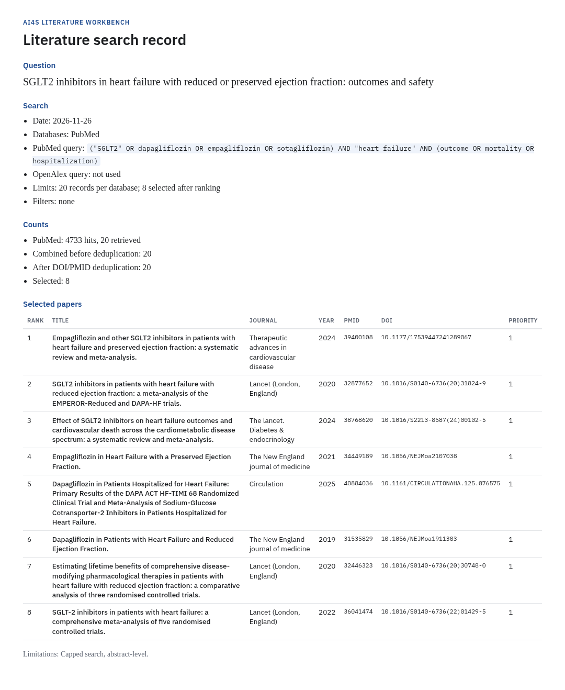
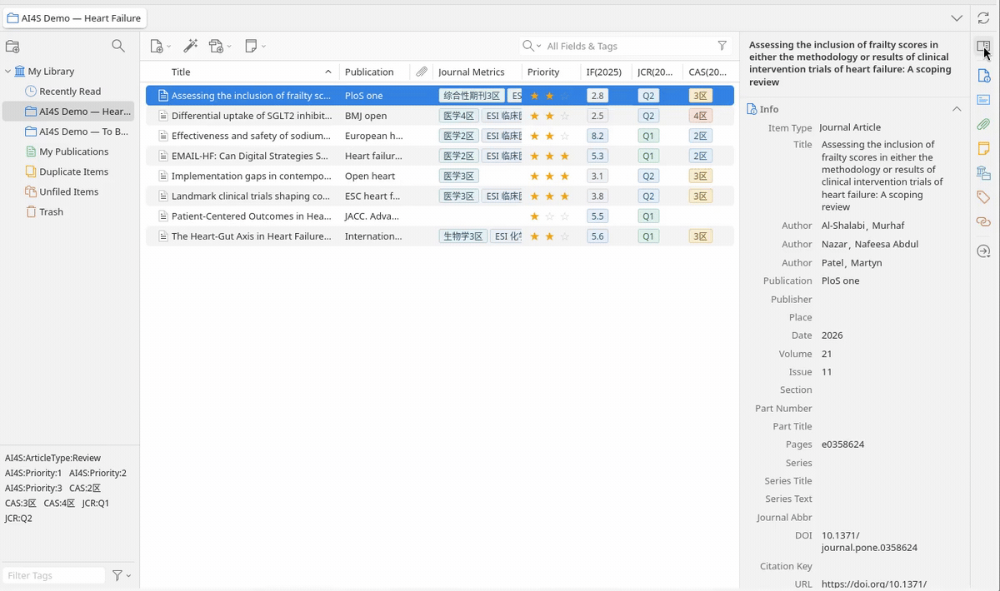
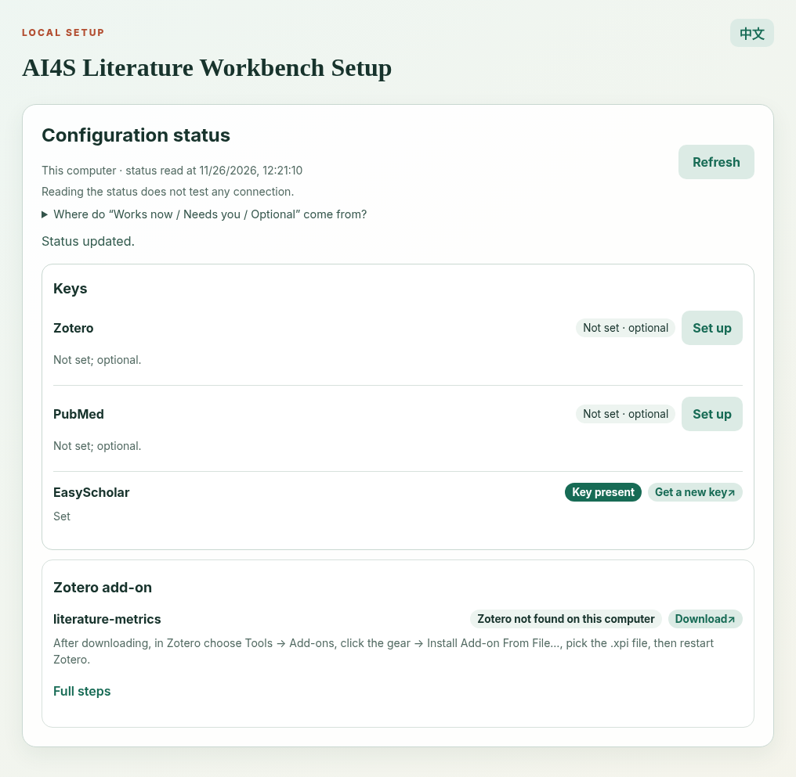

<h1 align="center">📚 AI4S Literature Workbench</h1>

<p align="center">
  <strong>基于 Zotero 和 Agent 驱动的一站式可溯源文献管理工作台</strong><br>
  <em>写综述和开题报告的时候，不用再费劲找引文出处</em>
</p>

<p align="center">
  🔎 自然语言检索 · 📚 Zotero 文献工作台 · ✍️ 可溯源引文插入
</p>
<p align="center">
  <a href="https://github.com/Frankkk1912/ai4s-literature-workbench/releases">📥 发布页</a> ·
  <a href="README.md">🇬🇧 English</a> ·
  <a href="#-快速开始">🚀 快速开始</a> ·
  <a href="docs/getting-started_CN.md">📖 入门</a>
</p>

---

## 🤔 为什么要做这个？

用自然语言描述研究问题即可。工作台会检索 PubMed 和 OpenAlex、合并去重并保存可复核的检索记录。它还能把入选文献同步到 Zotero，并基于已保存的证据起草正文，用 `[EV:n]` 标出引用来源。

| 阶段 | 输出结果 |
| --- | --- |
| 🔎 **检索与排序** | PubMed 和 OpenAlex 检索结果、DOI / PMID 去重、相关性评分和 Priority 1–3 阅读顺序 |
| 📚 **同步到 Zotero** | 入选文献和检索记录归入同一分类；按 DOI / PMID 精确复用已有条目，避免重复 |
| ✍️ **可溯源起草** | 论述关联已保存证据；证据较弱、仅有摘要或无法确认的引用单独列入待核查清单 |

检索有数量上限，初筛主要依据摘要。这两项限制都会写入检索记录。

## ⚔️ 方案对比

| | AI4S Literature Workbench | 手动整理 | 通用聊天机器人 |
| --- | --- | --- | --- |
| 📄 **文献来源** | 实时检索 PubMed 和 OpenAlex，按 DOI 或 PMID 合并 | 人工浏览多个数据库 | 依赖模型记忆，可能虚构引文 |
| 📝 **检索记录** | `report.md` 保存研究问题、检索式和数量 | 分散的个人笔记 | 不留可复现的项目检索记录 |
| 📚 **Zotero 联动** | 免密钥读取本地库；通过 API Key 或 Zotero 10+ 授权写入 | 手动导入和整理标签 | 无法直接访问你的 Zotero 文献库 |
| 📊 **IF 与分区** | 内置 2025 年 JCR/IF 数据；中科院分区来自 EasyScholar 或自定义指标表 | 逐本期刊查询 | 指标可能未核实或已过时 |
| ✍️ **综述起草** | 用 `[EV:n]` 关联已保存证据，并提供引文待核查清单 | 依靠记忆和手动查找笔记 | 无法直接读取你筛选的证据 |

## 🧰 核心功能

### 🔎 文献检索与排序

默认并行检索 PubMed 和 OpenAlex。OpenAlex 无需 API 密钥。结果优先按 DOI 合并，没有 DOI 时按 PMID 合并。

每次检索都会生成 `report.md`，记录研究问题、原始检索式、数量上限和各项计数。`ranked_all.json` 保存证据和评分依据。Priority 1–3 表示当前课题的阅读顺序，不代表证据质量。后续导入会保留手动修改的 Priority。

期刊指标默认使用内置且经核验的 2025 年 JCR/IF 表，按 ISSN 匹配。中科院分区来自 EasyScholar 或自定义指标表。指标不影响检索召回。

arXiv 仅在明确要求时加入。Web of Science 支持导入用户自行下载的官方 CSV / TSV 文件。

<p align="center"></p>

*一份示例 PubMed 检索记录（`report.md`）：研究问题、原始检索式、命中数量与入选文献列表。*

### 📚 Zotero 同步

读取本地 Zotero 无需 API 密钥。写入可使用 Zotero API Key，或在 Zotero 10+ 中完成本地授权。

项目同步会复用 DOI / PMID 精确匹配的条目，并将检索记录作为笔记保存到目标分类。标题和年份的模糊匹配需要你确认。

### ✍️ 可溯源写作与全文

写作需要已保存的 `ranked_all.json` 证据。初稿使用 `[EV:n]` 标记，并附参考文献核对表。证据较弱、仅有摘要或无法确认的引用会写入 `references_to_check.md`。

**全文只从合法开放获取来源获取。** 全文运行时仅使用公开 HTTP/HTTPS OA 链接，并校验正文 PDF。它不使用机构登录，也不绕过访问控制。未获取全文前，证据仍按「仅摘要」处理。

### 📊 `literature-metrics` Zotero 插件

可选的 Zotero 桌面插件显示 **IF / JCR / 中科院分区**、**Priority**、**Article Type**、**Agent Tags** 和 **AI Summary** 列。Agent 同步或刷新后，插件从条目的 `Extra` 字段读取这些值。

点击星级、按 `1` / `2` / `3` 或使用 **Set Priority**，只会修改 Priority 标签。插件不执行其他写入。

<p align="center"></p>

*在 Zotero 中按影响因子和 Priority 排序，并在选中条目时更新右侧详情面板。*

### 🔑 可选的本地 API 密钥

检索、排序和起草都不需要密钥。只在需要额外功能时添加对应密钥。

| 密钥 | 用途 | 获取方式 |
| --- | --- | --- |
| **PubMed** | 提高 PubMed 请求速率上限 | 使用免费的 NCBI 账号申请 |
| **Zotero** | 将论文和元数据写入 Zotero 文献库 | 使用免费的 Zotero 账号申请 |
| **EasyScholar** | 补充期刊指标，包括中科院分区 | 按 EasyScholar 的规定申请 |

本地配置页提供各服务的注册链接。让 Agent 打开密钥配置页，再把密钥粘贴到对应的掩码输入框。密钥只保存在本机私有文件中，不会贴进聊天，也不会暴露给 Agent。

读取本地 Zotero 不需要密钥。Zotero 10+ 也可以授权本地免密钥写入；更早版本只支持免密钥本地读取。

PubMed 和 EasyScholar 密钥在下一次检索时生效。添加 Zotero 密钥后需要重启客户端，再运行 `ai4s-setup` 确认。三把密钥都已配置时，仍可要求打开配置页修改。

<p align="center"></p>

*演示环境中的本地配置页。EasyScholar 已配置；页面显示 “Zotero not found”，是因为插件安装在隔离的演示 profile 中，扫描默认路径时不会找到它。*

## 🗣️ 使用示例

### 1. 检索并筛选课题文献
```text
帮我查 GLP-1 受体激动剂和心血管结局，PubMed 和 OpenAlex 都要，排个序，检索记录留下来。
```

### 2. 同步至 Zotero 分类
```text
把这次的检索记录和选中的论文放进 Zotero，分类名叫 "GLP-1 CVD Project"。库里已经有的按 DOI 或 PMID 对上。
```

### 3. 基于证据起草综述段落
```text
用我存好的排序结果和检索记录写一段中文综述。句子后面标 [EV:n]，对不上的参考文献单独列出来。
```

## 🚀 快速开始

### 前置条件

- 支持的客户端：**Claude Desktop**、**Claude Code**、**Codex**、**ChatGPT 桌面版**、WorkBuddy、CodeBuddy、Trae 或 Qoder。
- 同步分类和显示指标列需要 **Zotero 桌面版**。
- 可选的本地密钥配置页需要浏览器。

### 1. 安装（选你用的应用）

**Claude 桌面版 — Code 标签**

1. 从 [Latest Release](https://github.com/Frankkk1912/ai4s-literature-workbench/releases/latest) 下载 `ai4s-literature-workbench-<版本号>.zip`，核对 `SHA256SUMS.txt`。
2. 选择 **设置 → Plugins → Add → Upload plugin**，上传 zip。
3. 运行 `/reload-plugins` 或新开会话。

**Claude 桌面版 — Chat**

1. 通过 **设置 → Plugins → Add → Upload plugin** 上传同一个 zip。这里只会安装四个技能。
2. 下载**两个**扩展：`ai4s-literature-zotero-<版本号>.mcpb` 和 `ai4s-literature-fulltext-<版本号>.mcpb`。逐个核对 `SHA256SUMS.txt`；缺少任一文件或校验不符就停止。
3. 打开两个文件并点击 **Install**。Zotero 的可选设置保持默认；fulltext 没有必填设置或密钥。重启 Claude 桌面版。

Chat 不加载插件内的 MCP 服务。两个独立扩展负责提供工具。

**Claude Code 终端、Codex、ChatGPT 桌面版或 WorkBuddy**

将以下指令原样发送给客户端：

```text
请帮我从
https://github.com/Frankkk1912/ai4s-literature-workbench.git
安装这个插件到当前应用。严格按 INSTALL.md 操作；如果打不开仓库，就读
https://raw.githubusercontent.com/Frankkk1912/ai4s-literature-workbench/main/INSTALL.md
不要自己添加步骤。装好后，用通俗的话告诉我现在能用什么、我自己还需要做什么。
```

客户端请求 GitHub 或网络权限时，请选择允许。直接命令和其他客户端的安装方式见下方「其他 Agent 与手动安装」。

### 2. 首次运行

让 Agent 运行 `ai4s-setup`。它会检查连接、汇报可用功能，并执行一次小规模真实检索。只有技能的 Claude Chat 需要先安装上方两个扩展。

首次搜索时，按提示允许下载检索辅助程序。它约 15 MB；如果没有可用的 Python，还会下载约 30 MB 的 Python。文件只安装到用户目录，不需要管理员权限，也不修改系统级设置。

- **密钥：** 全部可选。只能通过本地配置页添加，不要发到聊天中。
- **读取本地 Zotero：** 打开 **设置 → 高级**，勾选 **允许这台电脑上的其他应用与 Zotero 通信**。
- **写入 Zotero：** 在本地配置页添加 Zotero API Key，或使用 Zotero 10+ 并在弹窗中选择「始终允许」。
- **指标列：** 下载 [`literature-metrics.xpi`](https://github.com/Frankkk1912/ai4s-literature-workbench/releases/latest/download/literature-metrics.xpi)，通过 **工具 → 插件 → 齿轮 → 从文件安装插件** 安装。重启 Zotero，再让 Agent 同步或刷新一个分类。

### 3. 执行第一次检索

先使用上方的「检索并筛选课题文献」示例，再尝试 Zotero 同步和起草示例。

完整上手说明见 `docs/getting-started_CN.md`。

<details>
<summary>安装验证状态与备用说明</summary>

- **桌面版 Code：** Mac 上已验证 v0.2.0 可上传，并能识别四个技能和两个本地服务。该已发布 zip 的相对 MCP 路径有问题。路径修复尚未在桌面版验证，也不在该发布产物中。
- **桌面版 Code 市场备选：** 选择 **Add → Add marketplace**，填写 `Frankkk1912/ai4s-literature-workbench`，安装插件并构建一次源码。此路线尚未验证。在这个标签中，`/plugin` 只会打开设置，不执行终端安装命令。
- **桌面版 Chat：** Mac 上已验证 v0.2.0 可显示四个上传技能。两个 `.mcpb` 扩展均由 CI 构建和校验，但尚未实机验证。它们使用 Claude 桌面版内置的 Node.js；其版本尚未确认，扩展要求 ≥ 22.13。
- **仅配置文件的路线：** ChatGPT 桌面版和 WorkBuddy 的 MCP 文件路线已在 Windows 11 验证。这些路线只连接工具，不加载技能。其余路线和平台的验证状态以 `INSTALL.md` 为准。
- **Zotero 10+ 本地写入：** 无密钥写入已按协议文档通过 Mock 测试，尚未在真实 Zotero 10+ 桌面窗口验证。
- **受保护的 Claude 配置：** 不要让 Agent 编辑 `~/Library/Application Support/Claude/` 下的文件。Mac 会保护此目录，实测拒绝 Agent 访问。[INSTALL.md](INSTALL.md) 中的手动配置仅供用户操作，是最后的备选方案。

</details>

<details>
<summary>常见问题排查</summary>

| 现象 | 解决方法 |
| --- | --- |
| 提示 `My search tools are not connected yet` | 重启客户端，再让它运行 `ai4s-setup`。 |
| 本地配置页未自动打开 | 访问 Agent 提供的链接并输入短码；或在解压后的发布目录中双击 `Setup AI4S.bat`（Windows）/ `Setup AI4S.command`（macOS）。macOS 若拦截，请右键选择 **打开 → 打开**。 |
| 无法读取或写入 Zotero | 重新检查「首次运行」中的 Zotero 设置。 |
| 指标列缺失或为空 | 确认插件已安装，重启 Zotero，再让 Agent 同步或刷新该分类。 |

</details>

<details>
<summary>其他 Agent 与手动安装</summary>

手动源码安装需要 Git，以及包含 npm 的 Node.js ≥ 22.13。Windows 使用相同命令。请直接运行 `node`，不要使用 `.ps1` 或 `.sh` 包装脚本。首次搜索会下载检索辅助程序，无需手动安装 `uv`。

```bash
git clone https://github.com/Frankkk1912/ai4s-literature-workbench.git
cd ai4s-literature-workbench
node scripts/bootstrap.mjs
```

**Claude Code 终端**：在终端执行以下命令，不要在桌面版 Code 标签中执行。完成后重启 Claude Code。

```bash
claude plugin marketplace add Frankkk1912/ai4s-literature-workbench
claude plugin install ai4s-literature-workbench@ai4s-literature-workbench
```

**Codex 和 ChatGPT 桌面版**：优先使用上方安装指令。其他或手动安装路线请按 [INSTALL.md](INSTALL.md) 中对应客户端的说明操作；ChatGPT 的 MCP 配置路线不会加载技能。

**WorkBuddy**：优先使用上方安装指令。MCP 配置文件备用路线见 [INSTALL.md](INSTALL.md)。

**CodeBuddy**（尚未验证）：在应用内执行以下命令，然后重启。

```bash
/plugin marketplace add Frankkk1912/ai4s-literature-workbench
/plugin install ai4s-literature-workbench@ai4s-literature-workbench
```

**Trae / Qoder**：在仓库根目录执行，将 `/path/to/project` 替换为目标工作区路径。

```bash
node scripts/install-host.mjs --host trae --target /path/to/project
node scripts/install-host.mjs --host qoder --target /path/to/project
```

</details>

<details>
<summary>开发者指南</summary>

`install-manifest.json` 是 `INSTALL.md` 的机器可读配套文件。Agent 按这两份文件执行安装。

在仓库根目录执行构建和检查：

```bash
node scripts/bootstrap.mjs
node --import ./runtime/node_modules/tsx/dist/loader.mjs --test "tests/*.test.mjs"
(cd runtime && npm run typecheck && npm test)
(cd fulltext-runtime && npm run typecheck && npm test)
(cd literature-metrics && npm ci && npm run check && npm test && npm run package)
```

各运行时包要求 Node.js ≥ 22.13。组件说明见 `docs/`，安全说明见 `SECURITY.md`。

</details>

## 🤝 参与贡献

欢迎提交 Issue 或 Pull Request。

## 📄 许可证

本项目基于 MIT 协议开源，详见 `LICENSE`。© Frank AI4S Skill contributors。

Zotero 交互层参考了 Oscar Devos 的 [Zoteus](https://github.com/oscardvs/zoteus)。第三方组件署名见 `THIRD_PARTY_NOTICES.md`。

---

<p align="center">
  <sub>📚 AI4S Literature Workbench · 让综述里的每一句引文都有据可查</sub>
</p>
